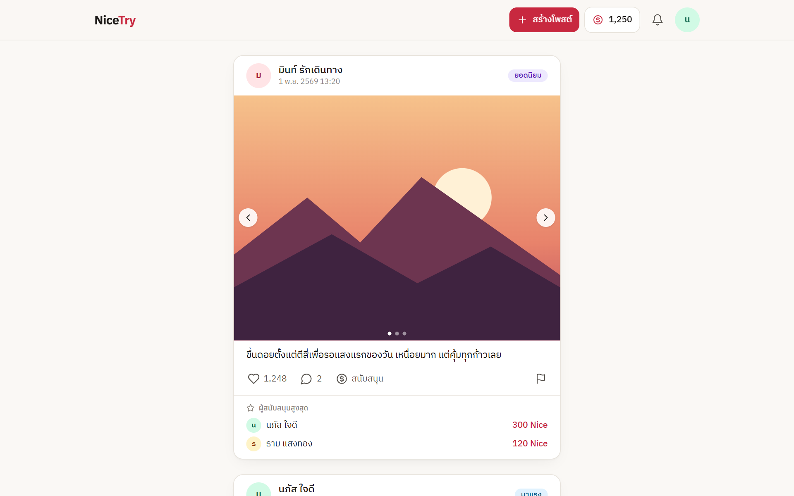
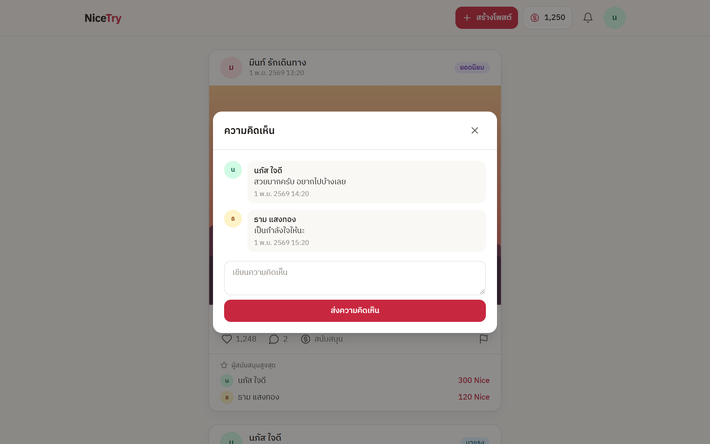
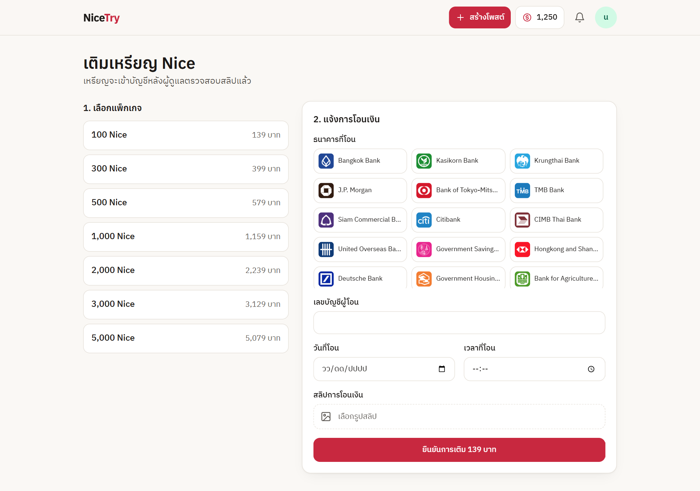
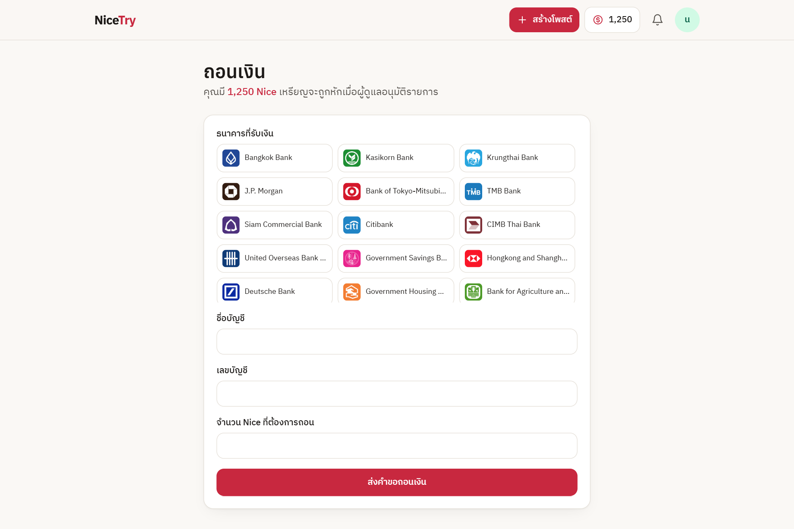
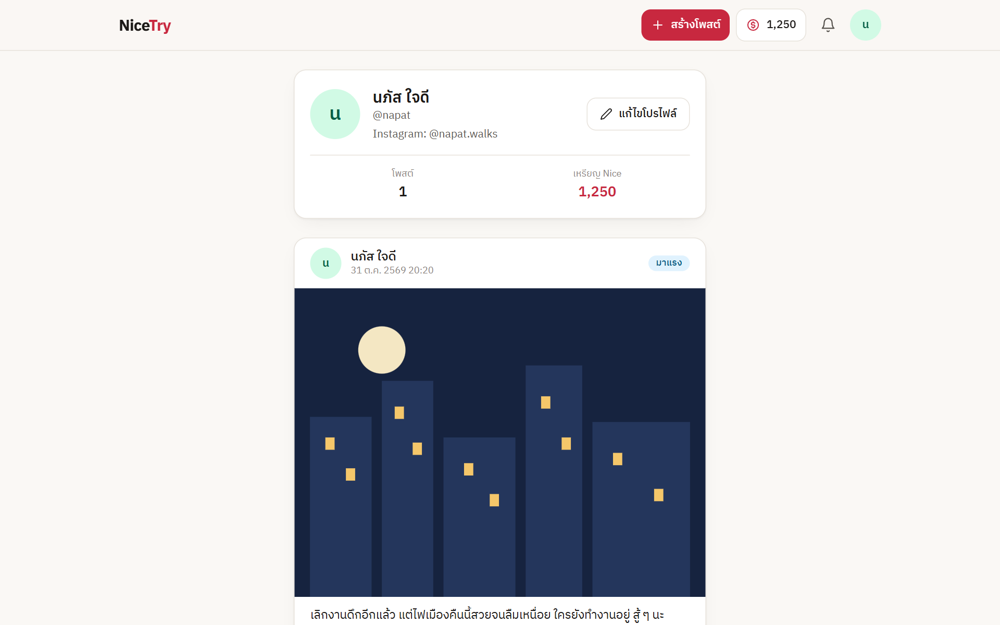
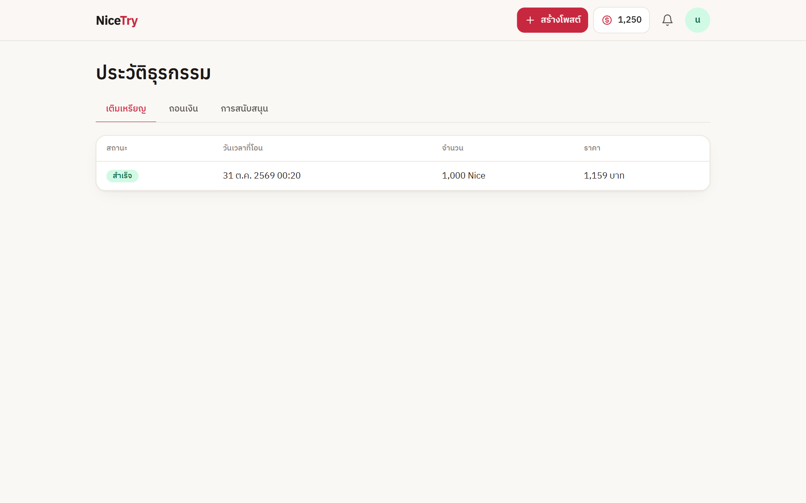
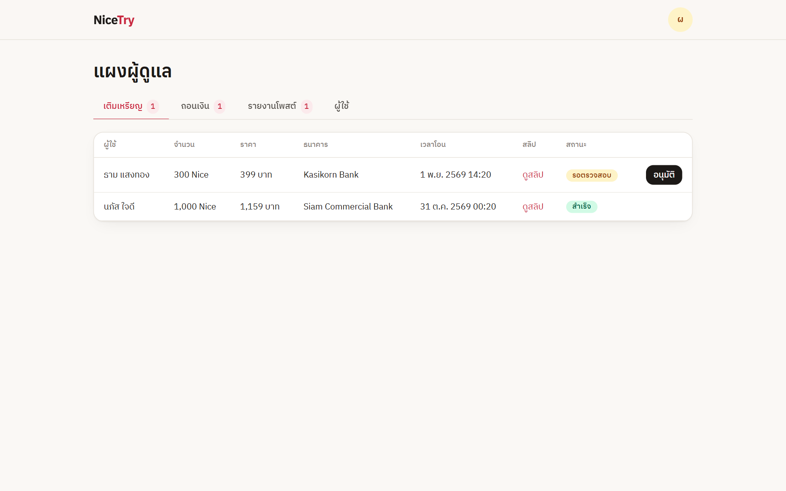
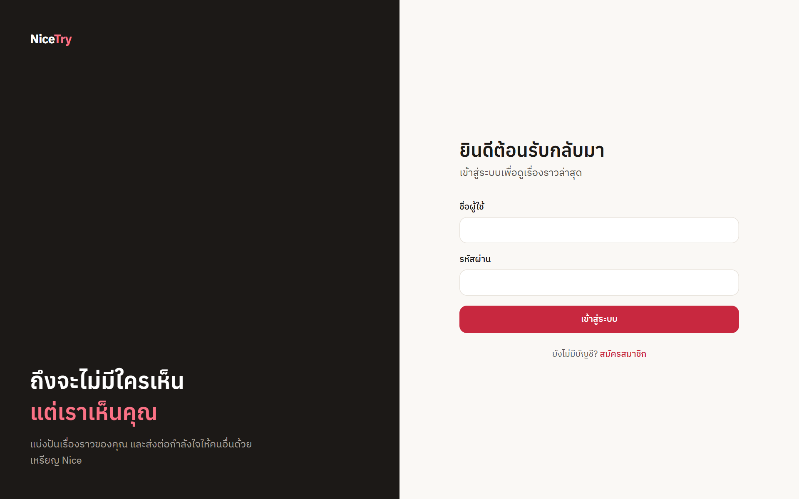
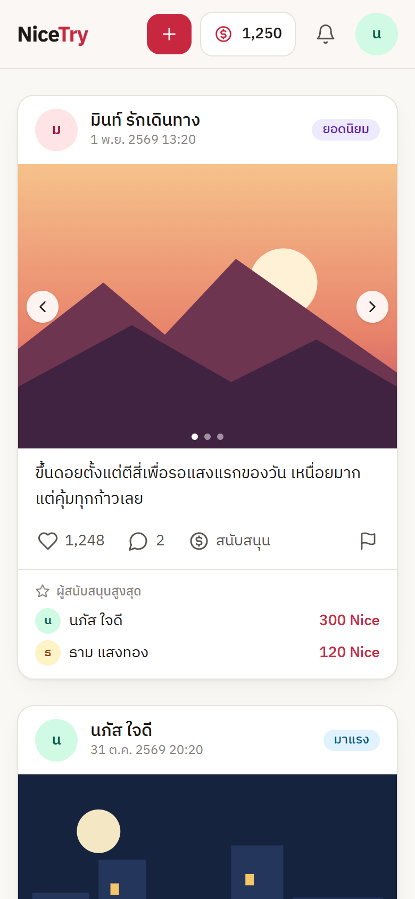

<div align="center">

# NiceTry

**ถึงจะไม่มีใครเห็น แต่เราเห็นคุณ**

พื้นที่แบ่งปันเรื่องราว และรับการสนับสนุนจากคนที่เห็นคุณค่าในตัวคุณด้วยเหรียญ Nice


</div>


## ตัวอย่างหน้าเว็บ

> รูปทั้งหมดใช้ข้อมูลตัวอย่าง

| ฟีดโพสต์ | ความคิดเห็น |
| --- | --- |
|  |  |

| เติมเหรียญ | ถอนเงิน |
| --- | --- |
|  |  |

| โปรไฟล์ | ประวัติธุรกรรม |
| --- | --- |
|  |  |

| แผงผู้ดูแล | เข้าสู่ระบบ |
| --- | --- |
|  |  |

<p align="center">
  
</p>

## ฟีเจอร์

**สำหรับผู้ใช้**

- สมัครสมาชิก เข้าสู่ระบบ และแก้ไขโปรไฟล์
- สร้างโพสต์พร้อมรูปได้สูงสุด 3 รูป และแก้ไขโพสต์ของตัวเอง
- กดถูกใจ แสดงความคิดเห็น และรายงานโพสต์
- สนับสนุนเจ้าของโพสต์ด้วยเหรียญ Nice พร้อมอันดับผู้สนับสนุนสูงสุดของแต่ละโพสต์
- เติมเหรียญด้วยการแนบสลิป และแจ้งถอนเงินเข้าบัญชีธนาคาร
- ดูประวัติการเติมเหรียญ การถอนเงิน และการสนับสนุน
- โพสต์ที่มียอดถูกใจสูงจะได้รับระดับ ตั้งแต่ "น่าจับตา" ไปจนถึง "ตำนาน"

**สำหรับผู้ดูแล**

- ตรวจสลิปและอนุมัติการเติมเหรียญ
- อนุมัติการถอนเงิน
- ตรวจรายงานและลบโพสต์ที่ไม่เหมาะสม
- ดูรายชื่อผู้ใช้และยอดเหรียญ

**ความปลอดภัย**

- ทุกรายการที่แก้ไขข้อมูลต้องมี JWT และตรวจสิทธิ์ที่ฝั่งเซิร์ฟเวอร์
- ยอดเหรียญคำนวณที่เซิร์ฟเวอร์เท่านั้น ด้วย transaction ของฐานข้อมูล
- รหัสผ่านเข้ารหัสด้วย bcrypt และไม่ถูกส่งออกทาง API

## เทคโนโลยีที่ใช้

| ส่วน | เทคโนโลยี |
| --- | --- |
| Frontend | Vue 3, Vue Router, Pinia, Tailwind CSS, Axios |
| Backend | Node.js, Express, Prisma, Joi, JSON Web Token, bcrypt |
| ฐานข้อมูล | MySQL |
| เก็บรูปภาพ | Firebase Storage |

## เริ่มต้นใช้งาน

### สิ่งที่ต้องมี

- Node.js 18 ขึ้นไป
- MySQL ที่สร้างฐานข้อมูลชื่อ `nicetry` ไว้แล้ว

### 1. ติดตั้งและรัน Backend

```bash
cd backend
npm install
cp .env.example .env
```

แก้ไขค่าในไฟล์ `backend/.env`

| ตัวแปร | ความหมาย |
| --- | --- |
| `DATABASE_URL` | ข้อมูลเชื่อมต่อ MySQL |
| `JWT_SECRET` | ข้อความสุ่มยาว ๆ สำหรับเซ็น token |
| `PORT` | พอร์ตของ API (ไม่บังคับ ค่าเริ่มต้นคือ 5000) |

สร้างตารางในฐานข้อมูล แล้วเริ่ม API

```bash
npx prisma db push
npm run dev
```

### 2. ติดตั้งและรัน Frontend

เปิด terminal ใหม่ที่โฟลเดอร์หลักของโปรเจกต์

```bash
npm install
npm run serve
```

เปิดเว็บที่ <http://localhost:8080>

ถ้า API ไม่ได้อยู่ที่ `http://localhost:5000/api` ให้สร้างไฟล์ `.env.local` แล้วกำหนด `VUE_APP_API_URL`

### 3. สร้างผู้ดูแลคนแรก

สมัครสมาชิกผ่านหน้าเว็บ แล้วกำหนดสิทธิ์ใน MySQL

```sql
UPDATE User SET role = 'ADMIN' WHERE username = 'ชื่อผู้ใช้ของคุณ';
```

## คำสั่งที่ใช้บ่อย

| คำสั่ง | โฟลเดอร์ | การทำงาน |
| --- | --- | --- |
| `npm run serve` | หลัก | รันเว็บสำหรับพัฒนา |
| `npm run build` | หลัก | build เว็บสำหรับใช้งานจริง |
| `npm run lint` | หลัก | ตรวจคุณภาพโค้ด |
| `npm run dev` | `backend` | รัน API และรีสตาร์ตเมื่อแก้โค้ด |
| `npm start` | `backend` | รัน API |

## โครงสร้างโปรเจกต์

```text
nicetry_project
├── backend
│   ├── controllers    ตรรกะของแต่ละฟีเจอร์
│   ├── lib            Prisma client และตัวช่วยจัดการ error
│   ├── middleware     ตรวจ token และสิทธิ์
│   ├── prisma         โครงสร้างฐานข้อมูล
│   └── routes         เส้นทาง API
├── docs/screenshots   รูปตัวอย่างใน README
├── public
└── src
    ├── assets         สไตล์กลาง
    ├── components     คอมโพเนนต์ที่ใช้ร่วมกัน
    ├── data           ข้อมูลธนาคารและแพ็กเกจเหรียญ
    ├── firebase       อัปโหลดรูปภาพ
    ├── router         เส้นทางของหน้าเว็บ
    ├── store          สถานะผู้ใช้
    ├── utils          ฟังก์ชันจัดรูปแบบข้อมูล
    └── views          หน้าเว็บแต่ละหน้า
```
